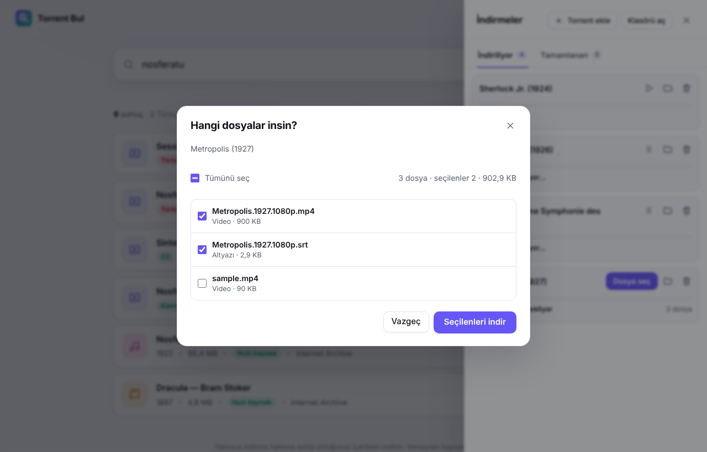
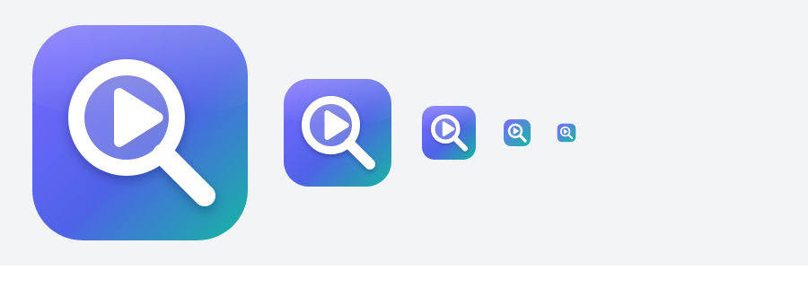

# Torrent Bul

Type a movie title, a topic or a genre; see the results, press **İndir** (Download). That's it.

Torrent Bul is a simple desktop torrent search and download app for Windows, macOS and Linux. Downloads are handled in the background by [qBittorrent](https://www.qbittorrent.org), one of the most reliable engines for connecting and finding peers. Torrent Bul starts it with its own separate profile and configures it itself; it doesn't touch your own qBittorrent settings or list. The interface is in Turkish.


*This screenshot was taken without internet access, so a film icon is shown where a poster couldn't load. Normally movies and series show their IMDb poster, and Internet Archive results show the Archive cover.*

## What it does

- **One search box:** type a title or topic and pick a category from the menu next to it (Film, Dizi / Series, Müzik / Music, Kitap / Books, Yazılım / Software, +18). The **Türlere göz at** (Browse genres) cards on the home page explore a genre in one click.
- **Sorting and filtering:** results are sorted from newest year to oldest by default. You can also sort by oldest, highest rated, most popular, genre or size, and show only one genre with the **Tür** (Genre) menu. Your choice is remembered.
- **Ratings and posters:** movies and series show their IMDb rating, genre and poster without any key (via Cinemeta). The info service is given at most 2.5 seconds; info that arrives late is ready on the next search. If you enter a free [OMDb](https://www.omdbapi.com/apikey.aspx) key in Settings, the info comes from there and vote counts are shown too. Internet Archive results show Archive's own rating and cover.
- **+18 section:** adult content is hidden from normal searches and only appears in the **+18** section of the category menu, after an age confirmation.
- **Turkish content first:** with the **Türkçe önce** (Turkish first) switch in the toolbar, results that look Turkish (language info, "Türkçe altyazılı", "TR dublaj", titles with Turkish characters) move to the top of the list. A lone "TR" tag doesn't count as Turkish. Results in other languages are still listed below; 1080p/4K releases move up and camera recordings (CAM/TS) move down.
- **License badge:** Internet Archive results with license information show a **CC** or **Kamu malı** (Public domain) badge.
- **One-click download:** progress, speed, time remaining and number of connections update live. Pause, resume, show in folder.
- **File selection:** in a multi-file torrent (season pack, releases with sample/extra files) you choose which files to download before it starts. The largest video and its matching (otherwise Turkish) subtitle come pre-selected; single-file torrents download without asking. The selection is saved, and unselected files are never downloaded.
- **Queue and speed limit:** at most 3 downloads run at once (1–10 in Settings); the rest wait as **Sırada** (Queued) and start when one finishes. Download and upload speed can be limited in KB/s (0 = unlimited).
- **Resume:** downloads left unfinished continue after you close and reopen the app. Settings and the download list are written crash-safe.
- **Completed tab:** finished downloads move to a separate tab, with a notification when they finish. Even if you move or delete finished files, the app won't download them again; you can do it on purpose with **Tekrar indir** (Download again) in the results.
- **.torrent files on your computer:** with **Torrent ekle** (Add torrent) in the Downloads panel, pick as many `.torrent` files as you like or a whole folder (or drag and drop them onto the window). They're all listed with their sizes; tick the ones you want and download them in one click.
- **Keep seeding (ratio):** on private trackers such as TurkSeed, turn on **Biten indirmeleri paylaşmaya devam et** (Keep seeding finished downloads) in Settings so your ratio doesn't drop. If you move the files, seeding stops, and still nothing is downloaded again.
- **Your library:** every finished video stays in the **Kütüphanen** (Your Library) strip on the home page with its poster, year and progress bar. Clicking it resumes where you left off; you can mark it as **İzlendi** (Watched). The library entry stays even if you remove the download from the list; if you moved the file it says "file not found".
- **.exe protection:** if a torrent downloaded as a movie contains executable files (.exe, .msi, .bat, .scr, .apk, etc.), those files are not downloaded and the card says "program file skipped". If the torrent contains only a program instead of the movie, the download doesn't start at all. Programs are only downloaded from results picked under the **Yazılım** (Software) category.
- **Built-in player:** watch videos in one click, even while they're still downloading. Subtitles inside the torrent (`.srt`, Turkish ones first) load before the download finishes; with **Altyazı yükle** (Load subtitle) you can also add a `.srt`/`.vtt` file from your computer. Playback speed (0.75×–2×) is remembered. For formats the browser can't play (MKV, AVI, HEVC/x265) the card explains why and suggests **Harici oynatıcıda aç** (Open in external player).
- **Magnet links:** paste a `magnet:` link into the search box to download it directly. The installed desktop app also opens magnet links from your browser.
- **Run in the tray (optional):** if you turn it on in Settings, downloads continue after you close the window; open or quit from the tray icon. By default, closing the window quits the app.
- **Light and dark theme:** follows the system setting.

## Screenshots

**Search results:** Turkish results first, with license badges (CC, Public domain) and genre.


**File selection:** in a multi-file torrent the largest video and its matching subtitle come pre-selected; sample files are left unticked.



**Downloads:** extra downloads wait as **Sırada** (Queued); a torrent waiting for file selection shows a **Dosya seç** (Choose files) button.


**Player:** resume, playback speed and **Altyazı yükle** (Load subtitle).


## Search sources

Sources work like plugins and are turned on and off in the **Ayarlar** (Settings) window.

| Source | Default | Description |
| --- | --- | --- |
| Internet Archive | On | Public domain and freely licensed movies, music, books and software. Downloads are fast because the files are also served directly from Archive's servers. |
| Torznab (Jackett / Prowlarr) | Off | For adding your own indexer. Enter its address and API key in Settings; the number of seeders is shown too. |

The app doesn't use any torrent site on its own.

### Adding other sites with Jackett (Linux)

```bash
cd ~ && wget https://github.com/Jackett/Jackett/releases/latest/download/Jackett.Binaries.LinuxAMDx64.tar.gz
tar -xzf Jackett.Binaries.LinuxAMDx64.tar.gz && cd Jackett && sudo ./install_service_systemd.sh
```

1. Open `http://127.0.0.1:9117` in a browser and add the sites you want with **+ Add indexer**.
2. Copy the **API Key** at the top right.
3. In Torrent Bul, press **Ayarlar → + Kendi indeksleyicini ekle** (Settings → + Add your own indexer); the address is filled in, paste the key and save.

Private sites you're a member of (e.g. TurkSeed) are in Jackett's list too: search for the name in **+ Add indexer** and enter your username and password.

Some Cloudflare-protected sites also need [FlareSolverr](https://github.com/FlareSolverr/FlareSolverr) in Jackett. To add a new source, write a module with a `search(params)` function under `src/providers/` and add it to the list in `src/search.js`.

> **Note:** Only download content you have the right to download. Downloading and sharing copyrighted content without permission is illegal in many countries; the responsibility lies with the user.

## Installation

Requirements: [Node.js](https://nodejs.org) 20 or later and qBittorrent.

```bash
sudo apt install qbittorrent-nox   # Linux: the version that runs without a window (recommended)
npm install
npm start          # opens with the desktop window
```

On Linux, run this once to add the app to the application menu with its icon:

```bash
npm run kisayol    # "Torrent Bul" appears in the menu and taskbar with its own icon
```

If the icon looks blurry in the dock, run the command again: it installs the vector icon and every size.



On Windows and macOS, installing the regular version from [qbittorrent.org](https://www.qbittorrent.org/download) is enough; Torrent Bul starts it minimised to the tray. On Linux, if `qbittorrent-nox` isn't there, the desktop `qbittorrent` is used too. If it's installed somewhere else, you can give its path with the `QBITTORRENT_BIN` environment variable.

To run it in the browser:

```bash
npm run web        # opens http://127.0.0.1:4517
```

### Building installers

```bash
npm run dist:win     # Windows .exe installer
npm run dist:mac     # macOS .dmg (on a Mac)
npm run dist:linux   # Linux AppImage
```

The output goes to the `dist/` folder. Downloads are saved to `İndirilenler/Torrent` (Downloads/Torrent) by default; you can change this in Settings.

## Development

```bash
npm test
```

The tests check Turkish detection and ranking, Internet Archive and Torznab queries, crash-safe writing of the state files, file selection, the library and watch history, the queue, and an end-to-end download with a real qBittorrent (from a local web source or a second qBittorrent peer). The tests need `qbittorrent-nox` installed. They run with GitHub Actions on every push and pull request.

Structure:

```
electron/main.js        Desktop window
bin/web.js              Browser mode
src/server.js           Local API (127.0.0.1 only, protected with a session key)
src/downloads.js        Download manager (file selection, queue)
src/qbittorrent.js      Download engine: starts qBittorrent and drives it through the Web API
src/library.js          Library and watch history
src/jsonfile.js         Safe JSON writing for state files
src/search.js           Combines the sources
src/ranking.js          Turkish detection and ranking
src/providers/          Internet Archive and Torznab sources
public/                 Interface (HTML, CSS, JS)
```

## License

[MIT](LICENSE)
