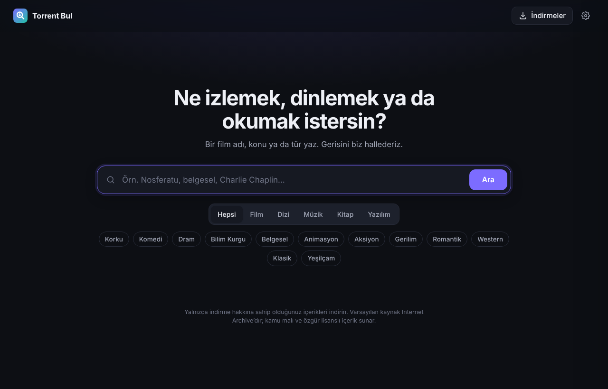
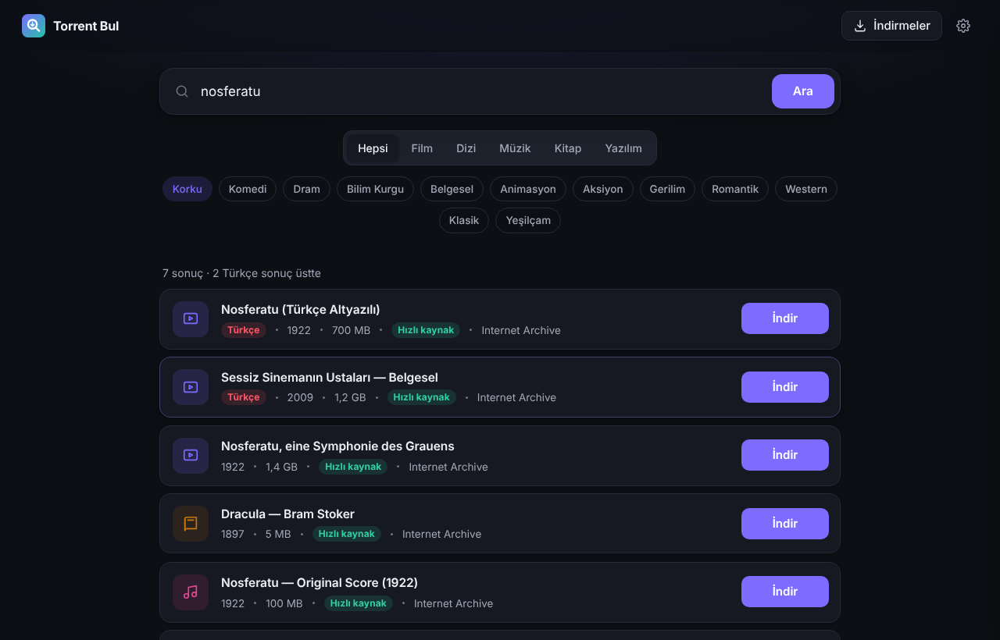
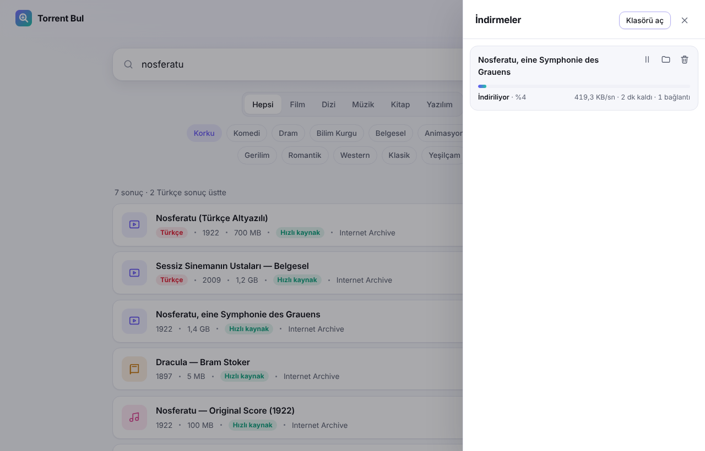

# Torrent Bul

Bir film adı, konu ya da tür yaz; sonuçları gör, **İndir**’e bas. Hepsi bu.

Torrent Bul; Windows, macOS ve Linux’ta çalışan sade bir masaüstü uygulamasıdır. Dahili torrent motoru (WebTorrent) sayesinde ayrı bir torrent programı kurman gerekmez.



## Neler yapar?

- **Tek kutudan arama:** film adı, konu (“sessiz sinema”), ya da tür kısayolları (Korku, Komedi, Belgesel, Yeşilçam…).
- **Türkçe içerik önce:** Türkçe olduğu anlaşılan sonuçlar (dil bilgisi, “Türkçe altyazılı”, “TR dublaj”, Türkçe karakterli başlıklar) listenin en üstüne çıkar. Diğer dillerdeki sonuçlar da altında listelenir.
- **Tek tıkla indirme:** ilerleme, hız, kalan süre ve bağlantı sayısı canlı görünür. Duraklat, devam et, klasörde göster.
- **Kaldığı yerden devam:** uygulamayı kapatıp açınca indirmeler sürer.
- **Magnet bağlantısı:** arama kutusuna bir `magnet:` bağlantısı yapıştırırsan doğrudan indirir.
- **Açık ve koyu tema:** sistem ayarını takip eder.




## Arama kaynakları

Kaynaklar eklenti mantığıyla çalışır ve **Ayarlar** penceresinden açılıp kapatılır.

| Kaynak | Varsayılan | Açıklama |
| --- | --- | --- |
| Internet Archive | Açık | Kamu malı ve özgür lisanslı film, müzik, kitap ve yazılımlar. Dosyalar doğrudan Archive sunucularından da beslendiği için hızlı iner. |
| Torznab (Jackett / Prowlarr) | Kapalı | Kendi kurduğun indeksleyiciyi eklemek için. Adresi ve API anahtarını Ayarlar’a gir; paylaşan (seeder) sayısı da gösterilir. |

Uygulama hiçbir torrent sitesini kendiliğinden kullanmaz. Yeni bir kaynak eklemek için `src/providers/` altına `search(params)` fonksiyonu olan bir modül yazıp `src/search.js` içinde listeye eklemen yeterli.

> **Not:** Yalnızca indirme hakkına sahip olduğun içerikleri indir. Telif hakkıyla korunan içeriğin izinsiz indirilmesi ve paylaşılması birçok ülkede yasaktır; sorumluluk kullanıcıya aittir.

## Kurulum

Gerekenler: [Node.js](https://nodejs.org) 20 veya üstü.

```bash
npm install
npm start          # masaüstü penceresiyle açar
```

Tarayıcıda çalıştırmak istersen:

```bash
npm run web        # http://127.0.0.1:4517 adresini açar
```

### Kurulum dosyası üretmek

```bash
npm run dist:win     # Windows .exe kurulum dosyası
npm run dist:mac     # macOS .dmg (Mac üzerinde)
npm run dist:linux   # Linux AppImage
```

Çıktılar `dist/` klasörüne yazılır. İndirilen dosyalar varsayılan olarak `İndirilenler/Torrent` klasörüne kaydedilir; bunu Ayarlar’dan değiştirebilirsin.

## Geliştirme

```bash
npm test
```

Testler; Türkçe öncelikli sıralamayı, Internet Archive ve Torznab sorgularını, ayarların saklanmasını ve yerel bir sunucudan web-seed’li bir torrent’in uçtan uca indirilmesini kontrol eder.

Yapı:

```
electron/main.js        Masaüstü penceresi
bin/web.js              Tarayıcı modu
src/server.js           Yerel API (yalnızca 127.0.0.1, oturum anahtarıyla korunur)
src/downloads.js        WebTorrent indirme yöneticisi
src/search.js           Kaynakları birleştirir
src/ranking.js          Türkçe öncelikli sıralama
src/providers/          Internet Archive ve Torznab kaynakları
public/                 Arayüz (HTML, CSS, JS)
```
