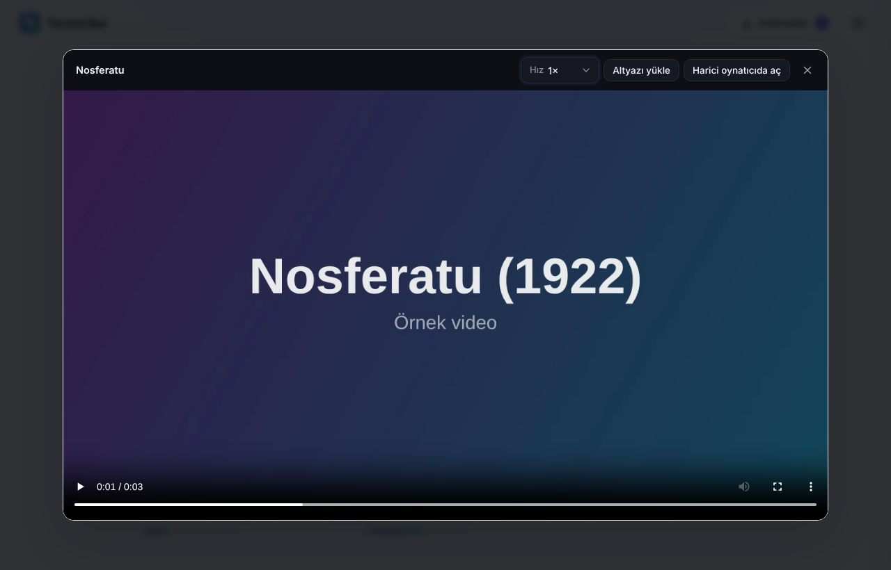

# Torrent Bul

Bir film adı, konu ya da tür yaz; sonuçları gör, **İndir**’e bas. Hepsi bu.

Torrent Bul; Windows, macOS ve Linux’ta çalışan sade bir masaüstü uygulamasıdır. Dahili torrent motoru (WebTorrent) sayesinde ayrı bir torrent programı kurman gerekmez.


## Neler yapar?

- **Tek kutudan arama:** film adı ya da konu yaz, yanındaki menüden kategori seç (Film, Dizi, Müzik, Kitap, Yazılım, +18). Ana sayfadaki **Türlere göz at** kartlarıyla tek tıkla türe göre keşfet.
- **Sıralama ve süzme:** sonuçlar varsayılan olarak en yeni yıldan eskiye sıralanır. En eski, en yüksek puan, en popüler, türe göre ya da boyuta göre de sıralayabilir, **Tür** menüsüyle yalnızca istediğin türü gösterebilirsin. Seçimin hatırlanır.
- **Puanlar:** Internet Archive kullanıcı puanı (10 üzerinden) gösterilir. Ayarlar’a ücretsiz bir [OMDb](https://www.omdbapi.com/apikey.aspx) anahtarı girersen film ve dizilerde IMDb puanı, tür ve afiş de görünür.
- **+18 bölümü:** yetişkin içerik normal aramalarda gizlenir, yalnızca kategori menüsündeki **+18** bölümünde ve yaş onayından sonra görünür.
- **Türkçe içerik önce:** (araç çubuğundaki **Türkçe önce** anahtarıyla) Türkçe olduğu anlaşılan sonuçlar (dil bilgisi, “Türkçe altyazılı”, “TR dublaj”, Türkçe karakterli başlıklar) listenin en üstüne çıkar. Tek başına “TR” etiketi Türkçe sayılmaz. Diğer dillerdeki sonuçlar da altında listelenir; 1080p/4K sürümler öne, kamera kayıtları (CAM/TS) arkaya düşer.
- **Lisans rozeti:** Internet Archive sonuçlarında lisans bilgisi varsa **CC** ya da **Kamu malı** rozeti görünür.
- **Tek tıkla indirme:** ilerleme, hız, kalan süre ve bağlantı sayısı canlı görünür. Duraklat, devam et, klasörde göster.
- **Dosya seçimi:** çok dosyalı bir torrentte (sezon paketi, örnek/ekstra dosyalı yayınlar) indirmeden önce hangi dosyaların ineceğini seçersin. En büyük video ve ona uyan (yoksa Türkçe) altyazı hazır işaretli gelir; tek dosyalı torrentler sormadan iner. Seçim kaydedilir, seçilmeyenler hiç inmez.
- **Kuyruk ve hız sınırı:** aynı anda en fazla 3 indirme çalışır (Ayarlar’dan 1–10), fazlası **Sırada** bekler ve biri bitince başlar. İndirme ve yükleme hızını KB/sn olarak sınırlayabilirsin (0 = sınırsız).
- **Kaldığı yerden devam:** uygulamayı kapatıp açınca yarım kalan indirmeler sürer. Ayarlar ve indirme listesi çökmeye karşı güvenli yazılır.
- **Tamamlanan sekmesi:** biten indirmeler ayrı bir sekmeye taşınır. Bitince bildirim gelir. Biten dosyaları başka bir yere taşısan ya da silsen bile uygulama onları yeniden indirmez; istersen sonuçtaki **Tekrar indir** ile bilerek indirebilirsin.
- **Bilgisayardaki .torrent dosyaları:** İndirmeler panelindeki **Torrent ekle** ile istediğin kadar `.torrent` dosyasını ya da bütün bir klasörü seç (veya pencereye sürükleyip bırak). Hepsi boyutlarıyla listelenir; istediklerini işaretleyip tek tıkla indir.
- **Paylaşmaya devam (oran):** TurkSeed gibi üyelikli sitelerde oranın düşmesin diye Ayarlar’dan **Biten indirmeleri paylaşmaya devam et**’i aç. Dosyaları taşırsan paylaşım durur, yine hiçbir şey yeniden inmez.
- **Kütüphanen:** biten her video ana sayfadaki **Kütüphanen** şeridinde afişi, yılı ve ilerleme çubuğuyla durur. Tıklayınca kaldığın yerden açılır; **İzlendi** olarak işaretleyebilirsin. İndirmeyi listeden kaldırsan da kütüphane kaydı durur; dosyayı taşıdıysan “dosya bulunamadı” yazar.
- **Dahili oynatıcı:** videoları tek tıkla izle; indirme sürerken bile izlemeye başlayabilirsin. Torrent içindeki altyazı (`.srt`, Türkçe olanlar öncelikli) indirme bitmeden de yüklenir; **Altyazı yükle** ile bilgisayarındaki bir `.srt`/`.vtt` dosyasını da ekleyebilirsin. Oynatma hızı (0,75×–2×) hatırlanır. Tarayıcının açamadığı biçimler (MKV, AVI, HEVC/x265) için kartta nedeni yazar ve **Harici oynatıcıda aç** önerilir.
- **Magnet bağlantısı:** arama kutusuna bir `magnet:` bağlantısı yapıştırırsan doğrudan indirir. Kurulu masaüstü uygulaması tarayıcıdaki magnet bağlantılarını da açar.
- **Tepside çalışma (isteğe bağlı):** Ayarlar’dan açarsan pencereyi kapatınca indirmeler sürer; tepsideki simgeden açıp çıkabilirsin. Varsayılan olarak kapatmak uygulamayı kapatır.
- **Açık ve koyu tema:** sistem ayarını takip eder.




## Arama kaynakları

Kaynaklar eklenti mantığıyla çalışır ve **Ayarlar** penceresinden açılıp kapatılır.

| Kaynak | Varsayılan | Açıklama |
| --- | --- | --- |
| Internet Archive | Açık | Kamu malı ve özgür lisanslı film, müzik, kitap ve yazılımlar. Dosyalar doğrudan Archive sunucularından da beslendiği için hızlı iner. |
| Torznab (Jackett / Prowlarr) | Kapalı | Kendi kurduğun indeksleyiciyi eklemek için. Adresi ve API anahtarını Ayarlar’a gir; paylaşan (seeder) sayısı da gösterilir. |

Uygulama hiçbir torrent sitesini kendiliğinden kullanmaz.

### Jackett ile başka siteleri eklemek (Linux)

```bash
cd ~ && wget https://github.com/Jackett/Jackett/releases/latest/download/Jackett.Binaries.LinuxAMDx64.tar.gz
tar -xzf Jackett.Binaries.LinuxAMDx64.tar.gz && cd Jackett && sudo ./install_service_systemd.sh
```

1. Tarayıcıda `http://127.0.0.1:9117` adresini aç ve **+ Add indexer** ile istediğin siteleri ekle.
2. Sağ üstteki **API Key**’i kopyala.
3. Torrent Bul’da **Ayarlar → + Kendi indeksleyicini ekle**’ye bas; adres hazır gelir, anahtarı yapıştırıp kaydet.

Üyeliğin olan siteler (ör. TurkSeed) de Jackett’ın listesinde: **+ Add indexer**’da adını arat, kullanıcı adı ve şifreni gir.

Cloudflare korumalı bazı siteler Jackett’ta ayrıca [FlareSolverr](https://github.com/FlareSolverr/FlareSolverr) ister. Yeni bir kaynak eklemek için `src/providers/` altına `search(params)` fonksiyonu olan bir modül yazıp `src/search.js` içinde listeye eklemen yeterli.

> **Not:** Yalnızca indirme hakkına sahip olduğun içerikleri indir. Telif hakkıyla korunan içeriğin izinsiz indirilmesi ve paylaşılması birçok ülkede yasaktır; sorumluluk kullanıcıya aittir.

## Kurulum

Gerekenler: [Node.js](https://nodejs.org) 20 veya üstü.

```bash
npm install
npm start          # masaüstü penceresiyle açar
```

Tarayıcıda çalıştırmak istersen:

```bash
npm run web        # http://127.0.0.1:4517 adresini açar
```

### Kurulum dosyası üretmek

```bash
npm run dist:win     # Windows .exe kurulum dosyası
npm run dist:mac     # macOS .dmg (Mac üzerinde)
npm run dist:linux   # Linux AppImage
```

Çıktılar `dist/` klasörüne yazılır. İndirilen dosyalar varsayılan olarak `İndirilenler/Torrent` klasörüne kaydedilir; bunu Ayarlar’dan değiştirebilirsin.

## Geliştirme

```bash
npm test
```

Testler; Türkçe tespitini ve sıralamayı, Internet Archive ve Torznab sorgularını, durum dosyalarının güvenli yazılmasını, dosya seçimini, kütüphane ve izleme kaydını, kuyruğu ve yerel bir sunucudan web-seed’li torrent’lerin uçtan uca indirilmesini kontrol eder. Her push ve pull request’te GitHub Actions ile çalışır.

Yapı:

```
electron/main.js        Masaüstü penceresi
bin/web.js              Tarayıcı modu
src/server.js           Yerel API (yalnızca 127.0.0.1, oturum anahtarıyla korunur)
src/downloads.js        İndirme yöneticisi (dosya seçimi, kuyruk)
src/engine.js           İndirme motoru adaptörü (WebTorrent)
src/library.js          Kütüphane ve izleme kaydı
src/jsonfile.js         Durum dosyaları için güvenli JSON yazma
src/search.js           Kaynakları birleştirir
src/ranking.js          Türkçe tespiti ve sıralama
src/providers/          Internet Archive ve Torznab kaynakları
public/                 Arayüz (HTML, CSS, JS)
```

## Lisans

[MIT](LICENSE)
